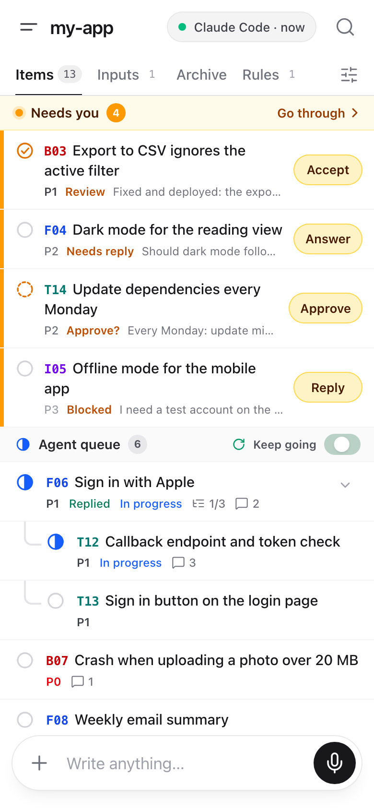
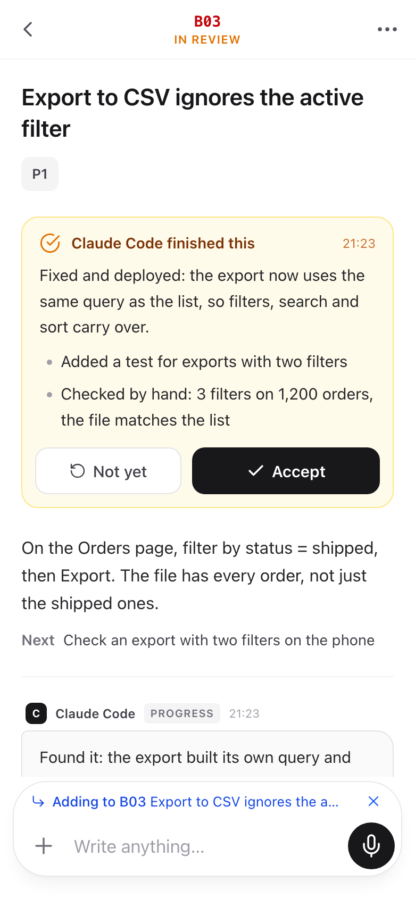
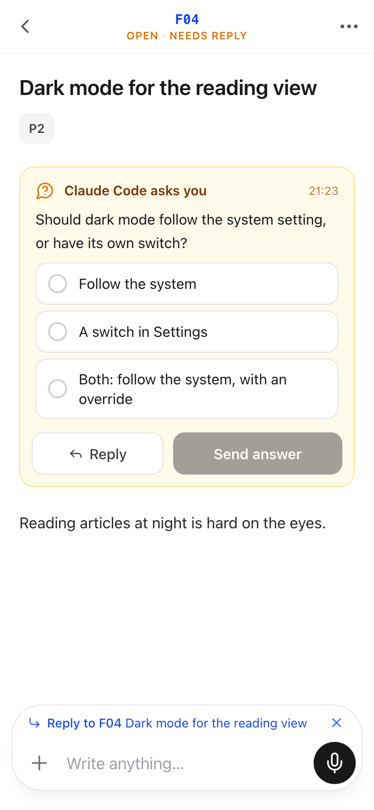
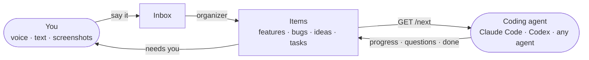

<div align="center">

# Taska

**One task list for you and your coding agents.**

Say what you want, by voice, text or screenshot. Your agents pick it up, do the work, and come back to you only when
they need you.


</div>

<p align="center">
  <picture>
    <source media="(prefers-color-scheme: dark)" srcset="docs/screenshots/list-dark.png">
    
  </picture>
  &nbsp;
  <picture>
    <source media="(prefers-color-scheme: dark)" srcset="docs/screenshots/review-dark.png">
    
  </picture>
  &nbsp;
  <picture>
    <source media="(prefers-color-scheme: dark)" srcset="docs/screenshots/question-dark.png">
    
  </picture>
</p>

## Why Taska

Coding agents work fast. Keeping up with them is the hard part:

- **Ideas get lost.** Bugs and features come to you at random, and chat history is a bad to-do list.
- **You can't tell what's happening.** Is the agent still working? Did it get stuck an hour ago?
- **Reviewing is slow.** The results are buried in long transcripts, and you're on your phone anyway.

Taska gives you and your agents one shared place for the work. You drop things in whenever they come up. Agents
read the queue over a plain-text API, work through it, and write back what they did. You see only what's
waiting on you: a question to answer, a plan to approve, finished work to accept.

## How it works



1. **Say it.** Type, paste a screenshot or record a voice note. You don't have to pick a type, a priority or a
   project first.
2. **It becomes items.** An organizer (Gemini, optional) turns what you said into features, bugs, ideas and tasks,
   or updates the ones that already exist. Without it, your agent does the organizing.
3. **Agents do the work.** An agent asks `GET /next` for the most important item, does the work, and posts
   progress, questions and results back to that item.
4. **You stay in control.** Finished work waits for you to accept it, and items an agent invents wait for your
   approval. When an agent is stuck, it says exactly what it needs.

## Features

**For you**

- **Needs you, first.** The list opens on what's waiting on you. The action sits right on the row: Accept,
  Approve, Answer or Reply. **Go through** takes you through all of them, one card at a time.
- **Built for the phone.** Swipe right to move an item forward and left for the rest. Long press for a preview.
  Every quick action can be undone.
- **Voice in, words out.** Voice notes are transcribed with your project's own terms, so names, paths and
  commands come out right.
- **Answers in one tap.** Agents can ask multiple-choice questions, and you answer with a tap.
- **The whole story of an item.** Its description, subitems, screenshots and documents, and the conversation
  with your agents: yours on the right, theirs on the left. Long reports fold to their first line.
- **Documents.** Agents write plans and designs into documents. You comment on a paragraph, on selected text, or
  on an area you circle.
- **See who's working.** A pill in the header says whether an agent is connected, was here a while ago, or is
  missing while work waits.
- **Many projects.** One server holds them all. A drawer switches between them and shows which ones need you.
- **Light and dark**, on a phone or a desktop.

**For your agents**

- **A plain-text API that saves tokens.** One line per item, short commands, no JSON to parse.
- **`/next` knows what's next.** New inputs come first, then items you replied on, then work in progress, then
  priority (P0 to P3), then the oldest item. Subitems come before their parent. `?wait=540` holds the request until new
  work arrives, so an agent can wait in the background.
- **A loop that keeps going.** With **Keep going** on, agents take one item after another without stopping. Turn
  it off, and they stop after the current one.
- **Works with any agent.** One command installs a skill for Claude Code, Codex and Antigravity. Any agent that
  can run `curl` can use the API.
- **Rules.** Standing instructions for the project, such as how to write commit messages, which every agent
  reads.

**Under the hood**

- **One Python file, standard library only.** No build step, no database, no Node.js, no packages to install.
- **Your data stays plain text.** Each project is an append-only JSON Lines file. The full history comes with it,
  and every change can be traced back to what you said.
- **Local first.** Taska runs on your machine. Reach it from your phone through a tunnel, protected by a key.

## Quick start

```sh
git clone https://github.com/ralphite/taska.git
cd taska
python3 taska.py
```

Then:

1. **Open Taska.** Go to http://127.0.0.1:7340, open the `default` project, and write your first thought in the
   box at the bottom.
2. **Organize automatically (optional).** Set `GEMINI_API_KEY` before starting Taska. What you write is then
   organized into items, and voice notes are transcribed.
3. **Connect a coding agent.** Open the menu (top left) and choose **Connect a coding agent**. It gives you one
   command to run in your project's folder:

   ```sh
   curl -s http://127.0.0.1:7340/p/<project>/connect | sh
   ```

   The command saves the project's address in `.taska` and installs the Taska skill for Claude Code, Codex and
   Antigravity. From then on, tell your agent to work on Taska and it knows what to do.

## The agent interface

`BASE` is the project's address, e.g. `http://127.0.0.1:7340/p/my-app`. Agents add `?by=claude-code` (or `codex`,
`antigravity`) so you can see who is around.

| Request | Returns |
| --- | --- |
| `GET BASE/agent` | How to use Taska (agents read this first) |
| `GET BASE/next` | What to do now; `?wait=540` waits for new work |
| `GET BASE/rules` | The project's rules |
| `GET BASE/inbox` | Inputs not organized yet |
| `GET BASE/items?q=&type=&pri=&when=&status=` | One line per item |
| `GET BASE/B03` | One item: fields, text, conversation, sources, images |
| `GET BASE/D1` | A document with numbered paragraphs and your comments |
| `GET BASE/log?n=30` | Recent changes |
| `POST BASE/do` | Write back, one command per line |

A session with `/do` looks like this:

```sh
curl -s "BASE/do?by=claude-code" --data-binary @- <<'EOF'
B03 doing
B03 progress Found it: the export built its own query and skipped the filters.
B03 ask Keep the old export as an option?
  - ( ) Yes, behind a setting
  - ( ) No, replace it
new bug P1 parent=B03 The PDF export has the same problem
EOF
```

What `/do` does here:
- An `ask` waits for your answer. You tap an option on your phone, and `/next` brings the item back to the agent.
- When the work is done, `B03 done` puts the item in review until you accept it.
- New items from an agent wait for your approval.

Codes are a type letter and a number: **F**eature, **B**ug, **I**dea, **T**ask, **R**ule.

## Use it on your phone

Taska is designed for the phone first. Open it in your phone's browser and add it to the Home Screen.

- **On the same network:** open your computer's address; no key is needed.
- **From anywhere:** put Taska behind a tunnel, such as a VS Code Dev Tunnel, and start it with
  `--public <tunnel address>`.
  - Requests through the tunnel need the key, which Taska creates in `~/.taska/key`.
  - **Use on your phone** in the menu gives you a link that carries the key. Open it once on the phone and the key
    is remembered.

> [!IMPORTANT]
> Taska trusts requests from this machine and your local network without a key. It recognizes forwarded requests
> by their `X-Forwarded-For` or `X-Forwarded-Host` header, and only those need the key. Use a tunnel that sets one
> of these headers. Dev Tunnels does.

## Configuration

| Setting | What it does |
| --- | --- |
| `--port 7340`, `--host 127.0.0.1` | Where Taska listens |
| `--root ~/.taska` | Where projects are stored, one folder each |
| `--public <url>` | The public address behind a tunnel, used for phone links and remote agents |
| `--organizer off` | Leave organizing to your agents, even with a Gemini key |
| `GEMINI_API_KEY` | Turns on the organizer and voice transcription |
| `TASKA_MODEL` | The Gemini model (default `gemini-flash-latest`) |

To keep Taska running, start `scripts/taska-service.sh` from a macOS LaunchAgent or a systemd unit. It reads the
public address from `$TASKA_PUBLIC` or `~/.taska/public-url`.

## Your data

- **Where it lives.** Everything is on your machine, in `~/.taska/<project>/`:
  - `taska.jsonl` holds every input, item, message and change, one JSON record per line, append only;
  - `taska-files/` holds images, files and voice notes.
- **What leaves your machine.** Only what you send to Gemini for organizing and transcription. That happens only
  when you set `GEMINI_API_KEY`.

## Development

- **One file.** The whole app is `taska.py`: server, storage, organizer, agent API, and the page itself. The page
  is written with Tailwind utility classes.
- **Run your changes.** Start a copy on another port with its own data: `python3 taska.py --port 7341 --root
  /tmp/taska-dev`.
- **Phone testing.** `.claude/skills/taska-mobile-qa` is a checklist for testing the phone UI on a copy of your
  data.
- **Design exploration.** `scripts/ui_mocks.py` asks Gemini for several phone designs of one screen and takes
  light and dark screenshots of each.

Taska grew out of [PROJECT_BRIEF.md](PROJECT_BRIEF.md), the original idea. It was then built by using it: coding
agents worked through Taska's own items.

## License

[MIT](LICENSE)
