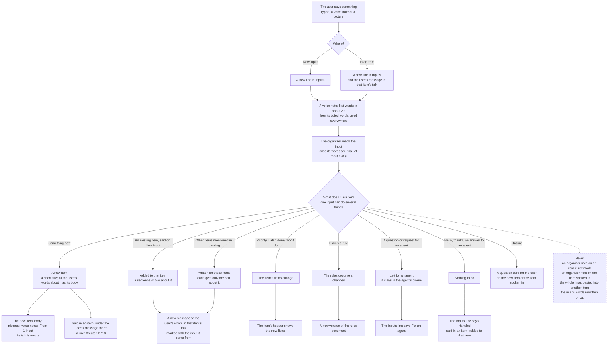
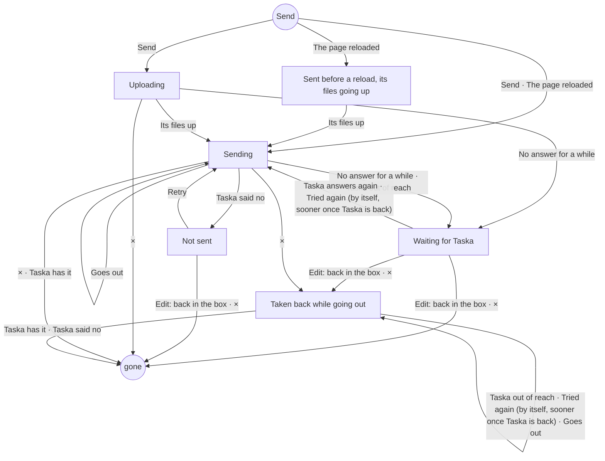
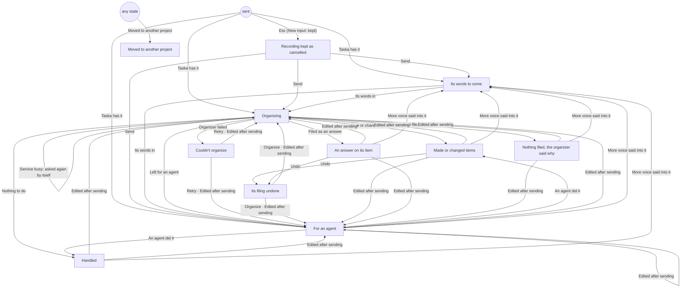

# What happens to an input

An input is one thing the user says: typed words, a voice note, pictures and files, or several of them together. This
is where it goes from the moment it is sent to the items it lands on. Each rule names where it was decided, so it can
be checked one by one. How a voice note is written out: D121; every state of a voice message and what each place shows
in it: [voice.md](voice.md). Taska's own copy of this page in Chinese: D126 (B714).

## Rules

| # | Rule | Source |
|---|---|---|
| 1 | Every input stays in Inputs as it was said; its line says what it became (Created B713, Added to T03, For an agent, ...) | B629 |
| 2 | Words said in an item show at once as the user's message in that item's talk (tidied words), without waiting for the organizer | B703 r1144, #10330 (replaced the choice in #10294) |
| 3 | The organizer writes no message on the item the input was said in: no repeat and no rewording; what needs doing it does by changing things | B703 r1141, #10330 |
| 4 | The organizer writes no message on an item it just made from the input: the item already shows the words, pictures and voice notes | B714 r1167 |
| 5 | The one message the organizer may write on those two items is a question for the user (an ask, with choices when there are some), when it is unsure; its notes and proposals there are dropped | B714 #10594 |
| 6 | An input said in an item that makes new items shows one line under the user's message there: → Created B713 (several: → Created B713, F714), each code opening its item; the same on the phone and the desktop | B714 #10594 |
| 7 | A new item's body is all the user's words about it, tidied: only fillers and words said twice go; never shortened, reordered or rewritten | F432, T697 (D121, B696) |
| 8 | A voice note's words word for word are only for the organizer to judge whether a word was misheard; they never go into a body | T697 (D121) |
| 9 | Another item mentioned in an input gets a sentence or two about it, marked with the input; the whole input is never pasted there | B452 |
| 10 | The rules change only when the user plainly says it is a rule ("rule", "from now on always ..."); anything the product or agents should do is an item | the organizer's instructions |
| 11 | A question or request for an agent is left for the agent; whatever else the input says still becomes items | the organizer's instructions |
| 12 | New items are P1 and Now; the user's own words ("urgent", "later") win | r10, r1072, R055 #9566 |
| 13 | When the organizer cannot be reached, Taska asks it again by itself; the user never presses Retry | T424 |

Where they are kept: rules 3 to 5 in `echo` (`server/taska/services/organizer.py`, tested in
`tests/test_organizer_echo.py`), the rest of the organizer's side in its instructions
(`server/taska/agent_text/organizer_text.py`); rule 1 in `web/src/model/became.ts` (`becameOf`) and
`web/src/model/inputStates.ts` (below), rule 6 in `web/src/model/became.ts` (`madeFrom`) and
`web/src/features/item/Talk.tsx`; rule 13 in `server/taska/domain/input_states.py` (`transient`) and
`web/src/model/outgoingStates.ts`.

## Where each case shows

| Case | Inputs | The new item | The item spoken in | Other items |
|---|---|---|---|---|
| Something new, on New input | Created B713 | body = the words; pictures, voice notes; From 1 input; empty talk | | |
| An existing item, on New input | Added to T03 | | | T03's talk: a message with the part about it |
| More detail, or an answer to an agent, in an item | Added to T03 | | only the user's message | |
| "Make it P0", "done" in an item | Added to T03 | | the user's message and the changed fields; no organizer note | |
| Something new, in an item | Created B713 | as in the first row | the user's message, with → Created B713 under it | |
| F12 mentioned in passing | also Added to F12 | | | F12's talk: a message with the part about it |
| Unsure what was meant | as the rows above | a question card, when it is the new item | a question card | |
| Plainly a rule | Changed the rules | | | a new version of the rules |
| A question for an agent | For an agent | | | in the agent's queue |
| An input edited after it was sent | read again, and left for an agent too | its items follow the new words | | |

## On its way to Taska

From Send until Taska has it, an input is on its way: in the page's outbox, kept in this browser, sent in order and
again until Taska has it (rule 13: when Taska cannot be reached it goes again by itself; Retry is only for one Taska
said no to). Its phases, every way between them (the event that causes it) and what each place shows in each phase,
its words, their colour and what can be done there, are defined once, in `web/src/model/outgoingStates.ts` (T728 #2);
every place that shows something on its way reads it there, and the outbox changes only by its steps (`outStep`). The
diagram and the table below are made from that file, and `web/src/model/outgoingStates.test.ts` fails when they differ
from it. A voice message on its way is in the voice state its phase names (Sending, Waiting for Taska, Not sent:
[voice.md](voice.md)). Once Taska has it, what became of it is below.

<!-- made from outgoingStates.ts: outgoingDiagram() -->

The tone in brackets is the colour: busy blue and moving, partial amber (it waits, nothing to do), failed red. ×
cancels it: it is not sent (one going out right now is deleted as soon as Taska has it). Edit takes it back into the
box to change it.

<!-- made from outgoingStates.ts: outgoingPlacesTable() -->
| Phase | its row in the desktop's New input list | the line over the phone's box (New input) | its row on the Inputs page | your bubble in the item's talk | an answer, on its question's card in the item's talk |
|---|---|---|---|---|---|
| Uploading (`uploading`) | Uploading… (busy) · × | Uploading… (busy) · × | Uploading… (busy) · × | Uploading… (busy) · × | Uploading… (busy) |
| Sending (`sending`) | Sending… (busy) · × | Sending… (busy) · × | Sending… (busy) · × | Sending… (busy) · × | Sending… (busy) |
| Waiting for Taska (`waiting`) | Waiting for Taska… (partial) · Edit × | Waiting for Taska… (partial) · Edit × | Waiting for Taska… (partial) · Edit × | Waiting for Taska… (partial) · Edit × | Waiting for Taska… (partial) |
| Not sent (`notSent`) | Not sent (failed) · Retry Edit × | Not sent (failed) · Retry Edit × | Not sent (failed) · Retry Edit × | Not sent (failed) · Retry Edit × | Not sent (failed) |
| Sent before a reload, its files going up (`reloaded`) | — | — | — | — | — |
| Taken back while going out (`takenBack`) | — | — | — | — | — |

## What became of it

Once Taska has an input, what became of it is one of the states below. Every state, every way between them (the event
that causes it) and what each place shows in each state, its words, their colour and what can be done there, are
defined once, in `web/src/model/inputStates.ts` (T728 #1); the state with what it names (the items, why it failed,
where it went) is worked out in one place, `becameOf` (`web/src/model/became.ts`), and every place reads both. The
diagram and the table are made from that file, and `web/src/model/inputStates.test.ts` fails when they differ from
it. Each state names the voice state a voice message is in then ([voice.md](voice.md)).

Taska's side of the same way is `server/taska/domain/input_states.py`: queued, organizing, failed, again (a failure the
service only was busy for: asked again by itself), undone, left, agents, handled, cancelled, moved, deleted, with the
steps between them; the organizer takes what it says is queued, an agent's inbox holds what it says is theirs, and
Undo of a filing goes through only when the organizer filed it and that filing is there to take back. Whether a
failure goes away by itself is one rule there (`transient`), told to the page as `org.again`: such an input is
Organizing, never Retry (rule 13).

<!-- made from inputStates.ts: inputDiagram() -->

The tone in brackets is the colour: busy blue and moving, failed red, done green, quiet grey, plain the items it went
to as links. Retry and Organize show only while the organizer is on to take it; Undo only where Taska would take back
what the organizer filed (`filing.can`); Move only when there is another project; Open goes to what it went to.

<!-- made from inputStates.ts: inputPlacesTable() -->
| State | its row in the desktop's New input list | its row on the Inputs page | the line over the phone's box (New input) | under your message in the item's talk | its menu (⋯, a long press) and Move |
|---|---|---|---|---|---|
| Its words to come (`transcribing`) | as model/voiceStates says it (busy) | as model/voiceStates says it (busy) | as model/voiceStates says it (busy) | as model/voiceStates says it (busy) | (nothing to do) |
| Organizing (`organizing`) | Organizing… (busy) | Organizing… (busy) | Organizing… (busy) | — | (nothing to do) |
| Made or changed items (`filed`) | its items: Created B014 · Added to F012 (plain) | its items: Created B014 · Added to F012 (plain) | its items: Created B014 · Added to F012 (plain) · Open, Undo, Move to… | → Created B713 (the items it made there) (plain) | Undo, Move to… |
| An answer on its item (`answer`) | Answer to T007 (plain) | Answer to T007 (plain) | Answer to T007 (plain) · Open, Undo, Move to… | — | Undo, Move to… |
| For an agent (`agent`) | For an agent (quiet) | For an agent (quiet) | For an agent (quiet) · Move to… | — | Move to… |
| Nothing filed, the organizer said why (`note`) | the organizer's words (quiet) | the organizer's words (quiet) | the organizer's words (quiet) · Move to… | — | Move to… |
| Handled (`handled`) | Handled (done) | Handled (done) | Handled (done) · Move to… | — | Move to… |
| Couldn't organize (`failed`) | Couldn't organize · why (failed) · Retry | Couldn't organize · why (failed) · Retry | Couldn't organize · why (failed) · Retry | — | Move to… |
| Its filing undone (`undone`) | Undone (quiet) · Organize | Undone (quiet) · Organize | Undone (quiet) · Organize | — | Move to… |
| Recording kept as cancelled (`cancelled`) | Cancelled (quiet) · Send | Cancelled (quiet) · Send | — | — | Send, Move to… |
| Moved to another project (`moved`) | Moved to Shop (plain) · Open | Moved to Shop (plain) · Open | Moved to Shop (plain) · Open | Moved to Shop (plain) · Open | — |

## Never

- The organizer writes a note or a proposal on an item it just made, or on the item the input was said in (a
  question for the user is the one message it may write there).
- The whole input is pasted into another item.
- The user's words are rewritten, shortened or summed up by the organizer's own reading of them.
- The user has to press Retry because the organizer could not be reached.
