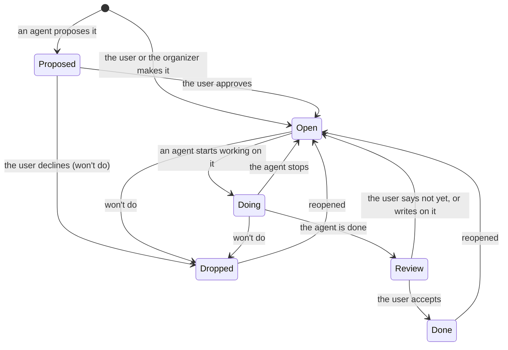

# Item states

What an item's status means, who moves it, and the rule that keeps exactly one side responsible at any moment.

`doing` (In progress) means an agent session is working on it now (r942). An item can also say who acts:

| Item | Shown as | Who acts |
|---|---|---|
| the agent's last word is an `ask` (its status stays as it is) | Needs you | the user |
| the user wrote after the agent's last word | Open (it is the agent's turn) | an agent, by priority |
| neither | Open | an agent, by priority |

An item needs you exactly while a form waits on you (T646): an agent's question (choices to pick, or a reply), a
proposal (Approve or Won't do) or finished work (Accept or Not yet), the last two until you reply there. An agent
that is stuck asks for what it needs: asking is the only way it waits on you (its old word `block` lands as an ask).

`when` (now or later) and `archived` are separate from the status.

## What an item needs from you

One model, `web/src/model/needStates.ts` (T728 #3), works out what an item needs from you and what every place
shows of it; the server's `rules.needs_you` is its list. The states are worked out in this order, the first that
holds being the item's: a question waits (whatever the status: the row, A and the swipe all answer it); a proposal or
finished work you have not spoken on since; the same with the agent's latest word a question with choices you
answered (its card holds Approve or Accept); the same once you replied instead; what you decided, while the agent has
not spoken since (the card stays where it was, faded, its buttons disabled, r1003). The table is made from the model
(a test keeps it so):

| State | Needs you: the list, its counts and the projects' (the server's needs_you) | its row in Needs you: the pill, and the line under its title | the item's status mark: Needs you while a question waits | A, and the row's way forward (the desktop's first action, the phone's swipe right) | the card in the item's talk |
|---|---|---|---|---|---|
| A question to answer (`answer`) | yes | Answer | Needs you | Answer | the question (Approve or Accept beside it) |
| A proposal to approve (`approve`) | yes | Approve | — | Approve | Won't do · Approve |
| Finished work to accept (`accept`) | yes | Accept | — | Accept | Not yet · Accept |
| Answered; Approve or Accept on the question (`onAnswer`) | — | — | — | Approve / Accept | none: Approve or Accept (or what you chose) on the answered question's card |
| You replied instead of deciding (`replied`) | — | — | — | Approve / Accept | Skipped · you replied, Approve or Accept |
| Decided (`decided`) | — | — | — | — | faded in place, what you chose said as done |
| Decided on the question you answered (`decidedOnAnswer`) | — | — | — | — | none: Approve or Accept (or what you chose) on the answered question's card |
| Nothing (`none`) | — | — | — | — | — |

## One side responsible at a time

- `doing` is only for work an agent session is doing now. An agent that hands back a result sets the item done (it goes to review) or asks; a result never sits in `doing` (T646). The agent guide says this in its LOOP part. Asking does not change the status by itself (D110, Yadong revoked that rule).
- Words from the user move the turn to the agent: on an item in review they set it back to open (as Not yet does, D110), and `/next` gives an item first only while an agent is working on it; other replies wait their turn by priority (B606).
- An agent that stops working on an item sets it back to open.
