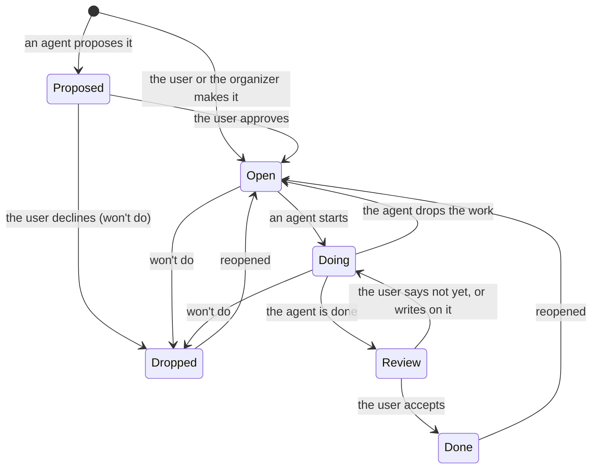

# Item states

What an item's status means, who moves it, and the rule that keeps exactly one side responsible at any moment.

`doing` has three cases, shown differently on the page:

| Case | How it got there | Shown as | Who acts |
|---|---|---|---|
| An agent is working | the agent set it doing and has not handed back yet | In progress | the agent |
| Waiting on the user | the agent's last word is an `ask` or a `block` | Needs you | the user |
| The agent's turn | the user answered or wrote on it after the agent's last word | Agent's turn | the agent |

`when` (now or later) and `archived` are separate from the status.

## One side responsible at a time

- `doing` is only for work an agent is doing. An agent that hands back a result sets the item done (it goes to review) or asks; a result never sits in `doing` (T646). The agent guide says this in its LOOP part.
- Words from the user move the turn to the agent: on an item in review they set it back to doing, and `/next` gives it to an agent first while an agent is in the middle of it (B606).
- An agent that stops working on an item sets it back to open.
