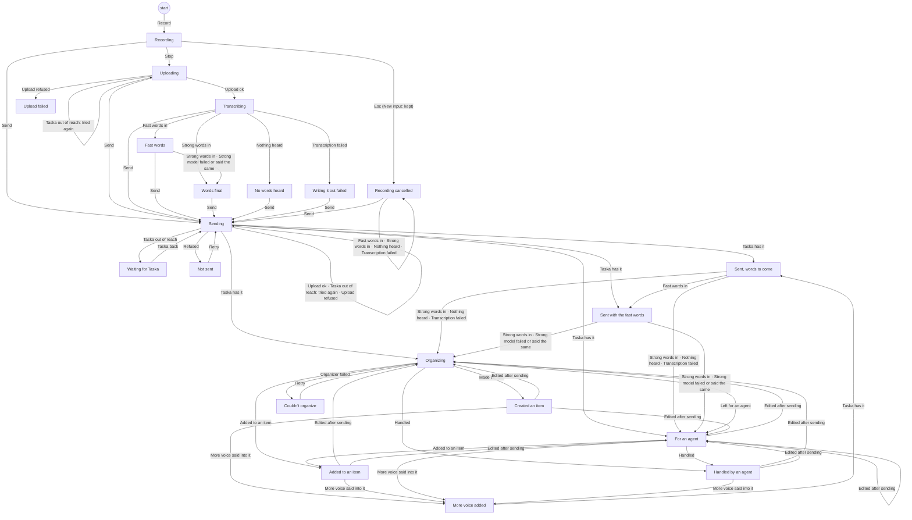

# A voice message's states

A voice message goes from recording, through its words being worked out and being sent, to what its input became.
Every state, every way between them (the event that causes it) and what each place shows in each state are defined
once, in `web/src/model/voiceStates.ts` (T726); every place that shows a voice note's state reads it there. The
diagram and the table below are made from that file, and `web/src/model/voiceStates.test.ts` fails when they differ
from it (its message prints them as they should be).

Before it is sent the note is the page's own: its state is worked out from what the page keeps of it
(`noteState`) and changed only by `noteStep`, which refuses a way the table does not have. Once Taska has it, the
note's record on the server is the truth for its words (`server/taska/domain/voice_states.py`: wait, done, none,
failed, with the steps between them), and what the input became is the input's own line (`web/src/model/became.ts`).
What happens to an input after that: [inputs.md](inputs.md). The Storybook page UI/Input box/Voice/Whole workflow
draws one row for each state, in each place.

Two models work out the words at once (T687): the fast words come in about 2 s, the strong model's replace them.
A message can be sent at any time, also before its words are final: it is then "Sent, words to come" or "Sent with
the fast words", and its final words come into it after (silently); the organizer waits for them.

## States and the ways between them

<!-- made from voiceStates.ts: voiceDiagram() -->

## What each place shows

"where it is on its way" is what the page says of anything sent (Sending…, Uploading…, Waiting for Taska…, Not
sent); "what became of it" is the input's line (Organizing…, Created B014, For an agent, ...). The tone in brackets
is the colour: busy blue and pulsing, partial amber, done green, quiet grey, failed red.

<!-- made from voiceStates.ts: voicePlacesTable() -->
| State | the note's chip in the box | the Draft card (the desktop's New input page) | its row in the desktop's New input list | the line over the phone's box (New input) | your bubble in the item's talk |
|---|---|---|---|---|---|
| Recording (`recording`) | — | — | — | — | — |
| Uploading (`uploading`) | Transcribing… (busy) | Transcribing… (busy) | — | — | — |
| Transcribing (`transcribing`) | Transcribing… (busy) | Transcribing… (busy) | — | — | — |
| Fast words (`fastWords`) | Partial · more coming (partial) | its words | — | — | — |
| Words final (`words`) | Transcribed (done) | its words | — | — | — |
| No words heard (`noWords`) | No words heard · audio only (quiet) | No words (quiet) | — | — | — |
| Writing it out failed (`wordsFailed`) | No transcript · audio only (quiet) | No words (quiet) | — | — | — |
| Upload failed (`uploadFailed`) | Upload failed (failed) | Upload failed (failed) | — | — | — |
| Sending (`sending`) | — | — | where it is on its way | where it is on its way | where it is on its way |
| Waiting for Taska (`offline`) | — | — | where it is on its way | where it is on its way | where it is on its way |
| Not sent (`notSent`) | — | — | where it is on its way | where it is on its way | where it is on its way |
| Sent, words to come (`sentTranscribing`) | — | — | Transcribing… (busy) | Sent · transcribing… (busy) | transcribing (busy) |
| Sent with the fast words (`sentFastWords`) | — | — | Transcribing… (busy) | Sent · transcribing… (busy) | transcribing (busy) |
| Organizing (`organizing`) | — | — | what became of it | what became of it | — |
| Created an item (`created`) | — | — | what became of it | what became of it | what became of it |
| Added to an item (`added`) | — | — | what became of it | what became of it | — |
| For an agent (`forAgent`) | — | — | what became of it | what became of it | — |
| Handled by an agent (`handled`) | — | — | what became of it | what became of it | — |
| Couldn't organize (`organizeFailed`) | — | — | what became of it | what became of it | — |
| Recording cancelled (`cancelled`) | — | — | what became of it | — | — |
| More voice added (`adding`) | — | — | Transcribing… (busy) | — | — |
